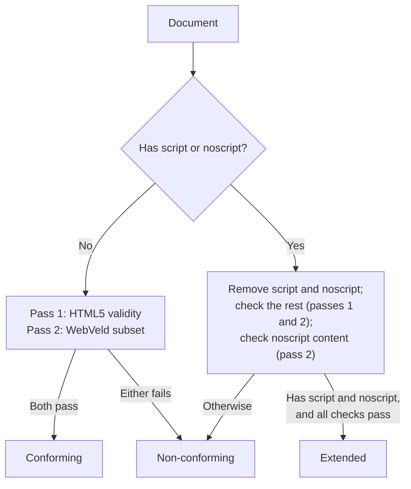

# WebVeld Implementation Guide

**Companion to:** [webveld-spec.md](webveld-spec.md) · **Status:** Informative

This document gives architectural guidance for building a conforming WebVeld browser, validator, or authoring tool. The [specification](webveld-spec.md) defines *what* conformance requires; this guide describes *how* to build within its implementability (rule 2) and privacy and safety (rule 3) rules. Nothing here is normative. Where this guide says MUST, it is restating a requirement of the specification.

---

## 1. Sizing

### 1.1 The budget

Rule 2 (spec §3.1) keeps the specification small enough that one developer or a small team can build a complete browser in a year or two. As a rough guide:

| Profile | Engine code (rough guide) |
| --- | --- |
| `webveld` | ~40,000 lines |
| `webveld-nano` | ~20,000 lines |
| `webveld-pico` | ~10,000 lines |

These figures count the browser's own code: HTML parsing, CSS cascade and style resolution, layout, rendering, and navigation. They do not count standard libraries for TLS, image decoding, font rendering and shaping, and windowing (for example OpenSSL or mbedTLS, libpng, libjpeg-turbo, FreeType and HarfBuzz, SDL or GTK). Requiring implementers to write their own TLS stack or JPEG decoder would measure those libraries, not the browser.

### 1.2 Reference points

The budget is calibrated against real engines:

- **Dillo** — a scriptless graphical browser maintained by a handful of people since 1999; its rendering engine is roughly 50,000 lines of C/C++.
- **Blitz** — a scriptless browser engine of roughly 36,000 lines of Rust, mostly written by one developer, reusing libraries for HTML parsing, CSS cascade, and font shaping. Its layout library, Taffy, adds roughly 19,000 more, and implements flexbox and grid compactly.
- **Amfora** — a terminal Gemini client of roughly 7,000 lines.
- **Modern engines** — Chromium, Gecko, and WebKit are tens of millions of lines and take hundreds of engineer-years to maintain.

Methods and exact measurements are in [implementability-continuum.md](research/implementability-continuum.md), [dillo-assessment.md](research/dillo-assessment.md), and [blitz-assessment.md](research/blitz-assessment.md).

### 1.3 Components

A full `webveld` browser consists of:

| Component | What it covers |
| --- | --- |
| HTML parser and tree builder | Tokenizer and tree construction for the allowed elements; no HTML5 error recovery |
| CSS parser and cascade | Selector matching, cascade (including `!important` for user style sheets), `calc()` |
| Block, inline, and table layout | Formatting contexts, margins, padding, borders, tables |
| Flexbox and bounded grid | Flex lines, grid track sizing within the 10,000-track bound |
| Text layout | Line breaking, bidirectional text (`dir`), font fallback, WOFF2 loading |
| Networking | HTTP/1.1 client, redirects, compression, TLS via a library |
| Browser shell | Navigation, URL bar, focus rings, forms, accessibility bridge |

The profiles drop components: `webveld-nano` drops flexbox, grid, tables, and forms; `webveld-pico` also drops the CSS cascade, the box model, and images.

---

## 2. HTML Parsing and Tree Construction

### 2.1 Omission of the HTML5 Error-Recovery Algorithm

The HTML5 parser's error-recovery algorithm, which copes with decades of malformed markup (unclosed tags, misnested tables, missing structure), is one of the larger parts of a mainstream browser.

WebVeld **browsers are not required to implement it** (spec §3.1). Authors make sure their documents are valid with an HTML5 checker (spec §2.6); a browser may reject malformed input or render whatever a simple parser can make of it.

### 2.2 Discarding Scripting and Template Elements

When building the DOM tree, conforming browsers MUST discard `<script>`, `<template>`, and `<slot>` elements along with all their child nodes and descendant text (spec §4.4). They must never be executed, inserted into the render tree, or exposed to the accessibility hierarchy.

### 2.3 Scoped Fallback Content Extraction

In non-conforming documents, browsers SHOULD drop `<object>`, `<embed>`, `<canvas>`, `<video>`, and `<audio>` themselves and render any conforming fallback content inside them (spec §4.4). For example:

```html
<object data="movie.swf">
  <p>Conforming fallback text rendered by WebVeld browser.</p>
</object>
```

Conforming documents never contain these elements.

### 2.4 Handling Unknown Elements

An element that is neither allowed nor forbidden (such as a newer element like `<search>`) is treated as an unknown HTML element: an inline container whose contents render normally (spec §4.4).

---

## 3. CSS Cascade, Properties, and Values

### 3.1 Cascade Engine and Author `!important`

Author style sheets are forbidden from using `!important` declarations (spec §6.1). However, conforming browser engines **must** implement `!important` in their CSS cascade resolver.

**User style sheets** (reader themes, high contrast, font preferences) rely on it. Because authors can't use `!important`, a reader's style sheet always wins.

### 3.2 Sizing Properties and Intrinsic Keywords

The sizing properties (`width`, `min-width`, `max-width`, `height`, `min-height`, `max-height`) accept length units, percentages, `auto`, and the intrinsic sizing keywords:
- `min-content`
- `max-content`

Implementations must calculate intrinsic sizes during layout passes:
- `min-content` width: the width of the longest unbreakable inline run (e.g. longest word or fixed-width child).
- `max-content` width: the width required to render the content with no soft wrapping.

The function `fit-content()` is explicitly excluded from both box sizing and grid track lists (spec §6.2, §6.7) to avoid complex two-pass shrink-to-fit negotiations.

### 3.3 Evaluating `calc()`

Mathematical `calc()` expressions (spec §6.2) are restricted to basic arithmetic (`+`, `-`, `*`, `/`) over permitted lengths, percentages, and numbers. Because CSS custom properties (`var()`) are forbidden (spec §6.7), `calc()` expressions contain no dynamic dependency graphs and can be evaluated at style resolution or layout time in a single linear pass.

### 3.4 Bounded CSS Grid Engine

Full CSS Grid is large. WebVeld permits a bounded subset (spec §6.2):
- Explicit track lists with lengths, percentages, `fr` fractional units, `auto`, `min-content`, `max-content`, `minmax()`, and literal integer `repeat()`.
- Explicit line placement (`grid-column`, `grid-row`, `span`).
- Default row-major auto-placement.

**Guarding against denial of service:** the explicit track count on either axis, and any integer count in `repeat()`, MUST NOT exceed **10,000** (spec §6.2, §8).

Implementers MUST verify track list bounds **before** allocating per-track data structures. An engine that allocates dynamic track memory before clamping can be exhausted by declarations such as `grid-template-columns: repeat(1000000, 1fr)`. Track resolution should be rejected or clamped upfront.

Excluded from Grid:
- Named areas (`grid-template-areas`) and named lines
- Implicit track auto-growth (`grid-auto-columns`, `grid-auto-rows`)
- Auto-packing flow (`grid-auto-flow: dense`)
- Container-dependent repetition (`repeat(auto-fill, ...)` and `repeat(auto-fit, ...)`)
- Subgrid and cross-grid baseline alignment

---

## 4. Form Controls and Constraint Validation

### 4.1 Regular Expression Safety (ReDoS Prevention)

The `pattern` attribute on `<input>` evaluates against user input during form constraint validation (spec §5.2). To prevent catastrophic backtracking (Regular Expression Denial of Service, ReDoS):
- Conforming documents MUST NOT use lookahead (`(?=...)`, `(?!...)`), lookbehind (`(?<=...)`, `(?<!...)`), or backreferences (`\1`, `\2`).
- Conforming browser engines MUST evaluate regexes in linear time $O(n)$ relative to input length (e.g. using Thompson NFA/DFA simulation, RE2, or Rust's `regex` crate) or enforce a strict bounded step limit.
- If a non-conforming document uses one of these constructs, the engine must ignore the `pattern` attribute for constraint validation without blocking form submission (matching HTML5 error handling).

### 4.2 Credentials and Transport Enforcement

Forms containing `<input type="password">` carry strict security requirements (spec §5.2, §8):
- The `action` attribute MUST resolve to an `https://` URL.
- Browsers MUST refuse to submit such a form over plain HTTP and MUST tell the reader why.

### 4.3 Autofill Token Filtering

Autofill hints on `<input>` are restricted to credential tokens: `username`, `current-password`, `new-password`, and `off` (spec §5.2).

Address and card tokens (`cc-number`, `street-address`, and so on) are excluded because a page can harvest them through hidden fields without any script. Mainstream browsers defend against this with heuristics that minimal browsers lack.

---

## 5. Network, Privacy, and Subresource Handling

### 5.1 Same-Origin Subresource Invariant

All embedded subresources (style sheets, images, and `@font-face` web fonts) MUST resolve to the document's own origin or be provided as inline `data:` image URLs (spec §7.2).

In the browser:
- Every cross-origin subresource request MUST be refused, in any document, conforming or not (spec §7.2). Enforce this in the fetch layer, not per element, so nothing slips through.
- Check the origin again after each redirect: a same-origin URL that redirects to another origin is refused too.
- A refused font falls back to the next family in the stack (spec §6.5); a refused image shows its `alt` text.
- `local()` is forbidden in documents because it enables font enumeration fingerprinting (spec §6.5).

### 5.2 Eliminating Interaction Timing Side-Channels

Mainstream browsers often defer fetching background images until an interactive pseudo-class matches (e.g. `:hover`, `:focus`, `:active`, `:target`, `:checked`).

In WebVeld, **deferred fetching is forbidden** (spec §6.3, §7.2):
- Any `url()` background image declared for an element present in the document MUST be fetched statically at document load time.
- Deferring requests to the moment of user interaction would leak reader activity and reading speeds to the server via network request timestamps.

### 5.3 Preventing Media Query Fingerprinting

Media queries are restricted to viewport width (`width`, `min-width`, `max-width`), `prefers-color-scheme`, and `@media print` (spec §6.6).

**`url()` values are FORBIDDEN inside `@media` blocks.** If background images or fonts could be referenced conditionally inside media queries, the browser would report the reader's viewport size and light/dark theme preference to the server through network request patterns.

### 5.4 HTTP Client Profile

Baseline HTTP behavior (spec §7.5):
- Automatically follow redirects (`301`, `302`, `303`, `307`, `308`) with a hop limit (minimum 5) to prevent infinite loops.
- Refuse redirects from HTTPS to HTTP when submitting sensitive form data.
- Support standard compression (`gzip`, `deflate`).
- Let the reader accept self-signed certificates (spec §8), so self-hosted sites can use TLS without a commercial certificate authority.

---

## 6. Accessibility and Platform Integration

### 6.1 Focus Indicators

Keyboard accessibility requires clear focus indicators (spec §9):
- The browser MUST draw a visible focus indicator on the focused link or form control, whether or not the document styles one.
- A document whose `:focus` rule removes the outline (`outline: none`, `outline-style: none`, or `outline-width: 0`) MUST replace it with another visible indicator in the same rule, such as a `background-color`, `border`, or `color` change.

### 6.2 Reader-chosen layout width

A browser may let the reader switch between narrow ("mobile") and wide ("desktop") layout, which simply changes the viewport width that width-based media queries see (spec §6.6). It needs no document markup, and because no fetch may depend on viewport width (spec §7.2), it reveals nothing to the server.

### 6.3 External Application Delegation

For formats the browser doesn't render (video, audio, PDFs, archives), browsers MAY hand files to external applications (spec §10):

1. **Security Staging:** Download files to a secure, isolated temporary directory before opening. Apply OS quarantine flags (e.g. `com.apple.quarantine`).
2. **Preventing Code Execution:** Never launch executable binaries, scripts, or unrecognized MIME types (`application/octet-stream`). Always force a download prompt for these types.
3. **Command Injection Prevention:** When delegating custom URI schemes (`mailto:`, `tel:`, `magnet:`, `gemini:`), treat the URI as an opaque string. Pass the URL directly to platform launchers (`xdg-open` on Linux, `open` on macOS, `ShellExecute` on Windows) without shell argument expansion or string concatenation.
4. **Non-blocking UI:** External application delegation MUST NOT navigate away from or close the currently displayed document.

---

## 7. Conformance Validation Architecture

Conformance is checked in two passes (spec §2.6), and a document is then classified into one of three states:



1. **Pass 1: HTML5 validity** — a standard checker such as the Nu Html Checker.
2. **Pass 2: WebVeld subset** — `webveld-validate`, which checks the element, attribute, CSS, and URL rules.

**Validate locally.** A browser that shows a conformance indicator MUST validate locally and MUST NOT send the document, its URL, or a hash of either to a validation service (spec §2.6).
